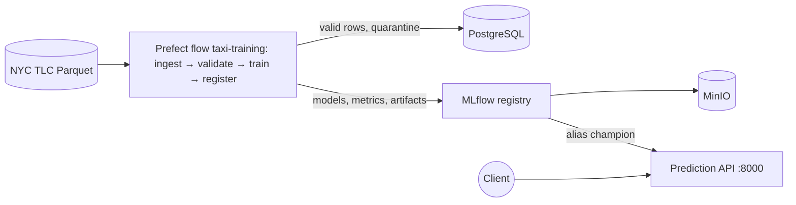

# TaxiFare platform: system under test for the QA Assistant subject

TaxiFare predicts the fare of a New York taxi trip before it starts. A training pipeline downloads real NYC TLC trips, validates them, trains a model, and promotes it in a model registry only when it beats the current one; an API serves the promoted model. It is the system that teams test in the **QA Assistant** subject of the AI Engineering / LLMOps project catalogue.

The platform works. Its automated test suite is deliberately thin: raising its coverage and its ability to catch defects, with the help of an assistant you build, is the point of the project.

- Expected behaviour: [`docs/FUNCTIONAL_SPEC.md`](docs/FUNCTIONAL_SPEC.md). Tests take their expected results from it.
- Tickets, team context and evaluation material: the QA Assistant folder of the project catalogue.

Work on your own fork or copy of tag `v1.0`.

## Architecture



| Service | Role | URL |
| --- | --- | --- |
| `prediction_api` | Serves the champion model (`/fare_predict`, `/health`, `/docs`) | http://localhost:8000 |
| `mlflow_server` | Experiments and model registry | http://localhost:5000 |
| `prefect_server`, `prefect_worker`, `prefect_bootstrap` | Orchestration of the training flow (daily, plus one run at start-up) | http://localhost:4200 |
| `db` | PostgreSQL: `training_trips`, `quarantine_trips` | localhost:5432 |
| `minio`, `minio_init` | Artifact storage for MLflow | http://localhost:9001 |

| Code | What it does |
| --- | --- |
| `services/pipeline/flow.py` | Preparation, ingestion, training, promotion (`should_promote`) |
| `services/pipeline/taxi_validation.py` | Validation schema and quarantine |
| `config/pipeline.yml` | Data-quality limits |
| `services/prediction_api/app.py` | Input contract, prediction, readiness, champion loading |

## Quick start

Prerequisites: Docker with Compose v2, internet access (images and NYC TLC Parquet), and [uv](https://docs.astral.sh/uv/) for the tests.

```bash
make up      # creates .env from .env.example if missing, builds and starts everything
make down    # stops everything (data is kept)   ·   make reset  # stops and erases all data
```

The first build compiles MinIO from source and takes several minutes. Then wait for the first training run (a few minutes): until a champion exists, the API answers 503.

```bash
curl -s localhost:8000/health
curl -s -X POST localhost:8000/fare_predict -H 'Content-Type: application/json' -d '{"pu_location_id": 132, "do_location_id": 230, "pickup_hour": 18}'
```

`.env.example` ships local-only passwords. Change them before exposing any port beyond localhost.

## Tests

Three levels, from the cheapest to the most realistic:

| Level | Needs | Where | Command |
| --- | --- | --- | --- |
| Unit | Python only | `tests/` | `make test` |
| Integration | Real dependencies started for the test (for example PostgreSQL, an MLflow registry) | to be written | to be defined by the team |
| End-to-end | The running platform (`make up`) with a champion | `tests/test_integration.py` (marker `e2e`) | `uv run --no-sync pytest -m e2e` |

```bash
uv sync --frozen --all-groups
make test        # end-to-end tests are skipped when the platform is not running
make coverage    # same, with branch coverage of services/
```

Baseline of the shipped suite (`v1.0`): 4 unit tests pass, 2 end-to-end tests are skipped without the platform, and branch coverage of `services/` is **43%** (`prediction_api` 60%, `flow` 40%, `taxi_validation` 67%, `bootstrap` and `init_bucket` 0%).

## Notes and limits

- The random 80/20 validation split is a simplification; a real project would use a temporal split.
- The Compose file publishes PostgreSQL, MinIO, MLflow, Prefect and the API on all interfaces, without authentication. Keep it on a local machine.

This repository is adapted from an internal NYC taxi teaching platform; it contains only its training and serving parts.
