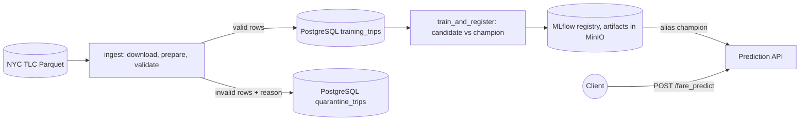

# TaxiFare platform: functional specification

This document is the reference for the expected behaviour of the platform. A test's expected result comes from here, not from running the code. When the code and this document disagree, that is a finding to report.

Version: `v1.0` of this repository. Ticket ids (`TX-…`) and criterion ids (`AC-…`) refer to the QA Assistant subject of the project catalogue.

## 0. Overview

The training flow runs in Prefect (`taxi-training`, once at start-up then daily). The API serves whichever model carries the `champion` alias.

## 1. Data preparation (`services/pipeline/flow.py`, `prepare_with_quarantine`)

- Source columns are renamed: `VendorID`→`vendor_id`, `RatecodeID`→`rate_code_id`, `PULocationID`→`pu_location_id`, `DOLocationID`→`do_location_id`, `Airport_fee`→`airport_fee`.
- Required columns: `vendor_id`, `rate_code_id`, `pu_location_id`, `do_location_id`, `passenger_count`, `tpep_pickup_datetime`, `fare_amount`. If any is missing: `ValueError("Missing required columns: [<sorted names>]")`.
- Derived features from `tpep_pickup_datetime`: `pickup_hour`, `pickup_dayofweek` (Monday = 0), `pickup_month`, and `pickup_weekday` = 1 from Monday to Friday, 0 on Saturday and Sunday.
- Target: `total_fare` = `fare_amount` + `extra` + `mta_tax` + `improvement_surcharge` + `tolls_amount` + `airport_fee`. Optional components that are absent or empty count as 0.
- Output columns, in this order: the 9 features `vendor_id`, `rate_code_id`, `pu_location_id`, `do_location_id`, `passenger_count`, `pickup_hour`, `pickup_dayofweek`, `pickup_month`, `pickup_weekday`, then `total_fare`. The index is reset.

## 2. Validation and quarantine (`services/pipeline/taxi_validation.py`)

- Valid ranges (inclusive): `vendor_id` 1-7, `rate_code_id` 1-99, `pu_location_id` and `do_location_id` 1-265, `passenger_count` 1-10, `pickup_hour` 0-23, `pickup_dayofweek` 0-6, `pickup_month` 1-12, `pickup_weekday` 0 or 1; `total_fare` strictly between 0 and 5000. No value may be missing. Infinite values count as missing. Non-numeric values count as missing.
- An invalid row is never dropped silently: it is quarantined with a `reason` of the form `<column>: <check>` (several reasons joined by `; `).
- If more than 20% of the rows are quarantined (strictly more), preparation fails with a `ValueError`. Exactly 20% is accepted.
- If fewer than 100 valid rows remain, preparation fails with a `ValueError`. Exactly 100 is accepted.
- Both limits come from `config/pipeline.yml` (`validation.max_invalid_share`, `validation.min_valid_rows`); the path can be overridden with `PIPELINE_CONFIG`. No limit is hard-coded.

## 3. Ingestion (`ingest` task)

- `month` must be 1 to 12 and `limit` at least 100, otherwise `ValueError("Invalid month or row limit")`, before any download.
- The month file `yellow_tripdata_<year>-<month>.parquet` is downloaded and its first `limit` rows are prepared and validated.
- Valid rows go to `training_trips`, quarantined rows (with their reason) to `quarantine_trips`, both with a `source` key derived from the URL and the limit.
- Ingesting the same source twice does not duplicate any row: the second ingestion writes nothing.
- The task retries 3 times on failure, 10 s apart.

## 4. Training and promotion (`train_and_register` task, `should_promote`)

- The training set is the whole `training_trips` table (all ingested batches). It is split 80/20 with a fixed seed.
- The candidate is a random forest (50 trees by default, `N_ESTIMATORS` overrides; depth 8; fixed seed).
- The candidate and the current champion are scored on the same validation split (RMSE).
- `should_promote(candidate_rmse, champion_rmse)` is true when there is no champion (`None`) or when the candidate RMSE is strictly lower. A tie keeps the champion.
- Every candidate is registered as a new version of `NYC_Taxi_Fare_Model`, promoted or not.
- The run logs the metrics `rmse` and `r2`, the parameters `training_rows`, `validation_rows`, `n_estimators`, the ingested batch as `data/training_sample.parquet`, and the tags `training_sample_sha256`, `model_version` and `promoted_to_champion` (`True` or `False`).
- The `champion` alias moves only after the model and its artifacts are stored.
- The task returns `{"version", "promoted", "rmse", "champion_rmse", "rows"}`; `champion_rmse` is `None` for the first model.

## 5. Prediction API (`services/prediction_api/app.py`)

### 5.1 Input contract of `POST /fare_predict`

Every field has a default value, so an empty JSON object is a valid request. Bounds are inclusive. The API bounds of the 9 features are the same as the validation ranges of section 2.

| Field | Type | Bounds | Default |
| --- | --- | --- | --- |
| `pickup_longitude`, `dropoff_longitude` | float | -180 to 180 | 0.0 |
| `pickup_latitude`, `dropoff_latitude` | float | -90 to 90 | 0.0 |
| `passenger_count` | float | 1 to 10 | 1.0 |
| `vendor_id` | int | 1 to 7 | 1 |
| `rate_code_id` | float | 1 to 99 | 1.0 |
| `pu_location_id`, `do_location_id` | int | 1 to 265 | 1 |
| `pickup_hour` | int | 0 to 23 | 12 |
| `pickup_dayofweek` | int | 0 (Monday) to 6 | 0 |
| `pickup_month` | int | 1 to 12 | 1 |
| `pickup_weekday` | int | 0 or 1 | 1 |

Coordinates are accepted and ignored by the model.

### 5.2 Responses of `POST /fare_predict`

| Situation | Status | Body |
| --- | --- | --- |
| A field is out of bounds or of the wrong type | 422 | `{"detail": "Invalid request", "fields": [<sorted names of the faulty fields>]}` |
| No model loaded | 503 | `{"detail": "Model not yet available"}` |
| The model raises during inference | 500 | `{"detail": "Prediction failed"}` (no internal error text) |
| Valid request, model loaded | 200 | `{"predicted_fare": <fare rounded to 2 decimals>, "model_version": "<version>"}` |

- Validation happens first: an invalid request returns 422 even when no model is loaded.
- The model is never loaded during a request.
- Logs name the faulty fields of a rejected request, never their values.

### 5.3 `GET /health` (readiness)

| Situation | Status | Body |
| --- | --- | --- |
| No model loaded | 503 | `{"status": "unavailable", "model_loaded": false, "reason": "no champion model loaded"}` |
| Model loaded but the smoke prediction raises | 503 | `{"status": "unavailable", "model_loaded": true, "reason": "model cannot predict"}` |
| Model loaded and answers | 200 | `{"status": "ok", "model_loaded": true, "model_version": "<version>", "smoke_fare": <fare rounded to 2 decimals>}` |

### 5.4 Model loading (`load_champion_model`)

- The API looks up the alias `champion` of `NYC_Taxi_Fare_Model`: every 5 s while no model is loaded, every 60 s afterwards.
- When no champion exists, it returns `False` and keeps the current state.
- When the champion version differs from the loaded one, it loads that version and remembers it; when it is the same, it loads nothing.
- A new champion is therefore served within about 60 s, without restarting the API.

## 6. Running the platform

`make up` starts PostgreSQL, MinIO, MLflow, the Prefect server and worker, and the prediction API. A first training run starts automatically; until it promotes a model, `/fare_predict` and `/health` return 503.
